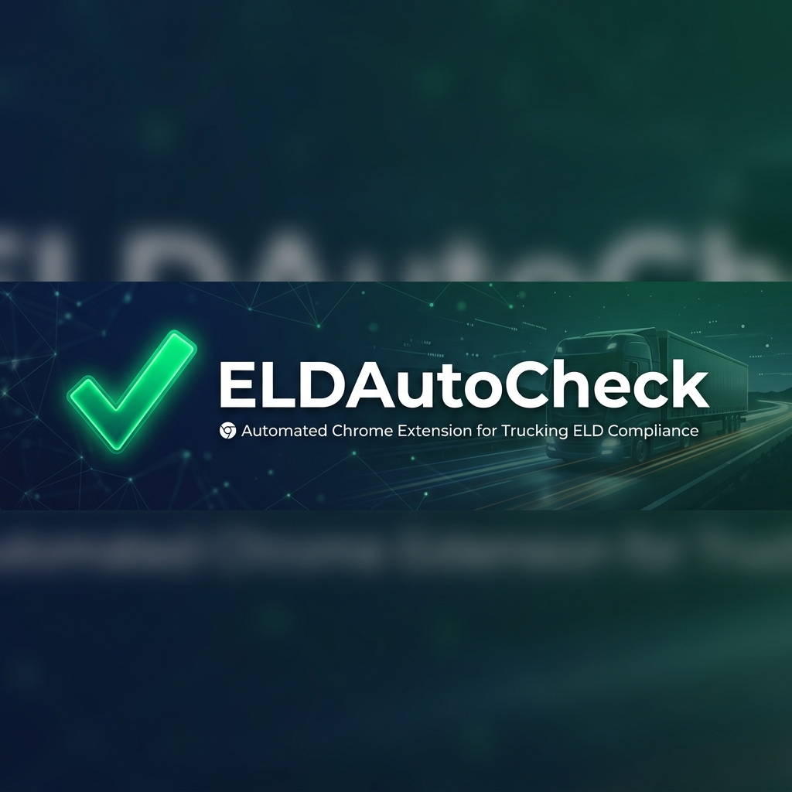

<p align="center">
  
</p>

<p align="center">
  <strong>⚡ Automate your HOS compliance workflow on TrendyELD — in seconds, not minutes.</strong>
</p>

<p align="center">
  <a href="#-features"></a>
  <a href="#-installation"></a>
  <a href="#-hotkeys"></a>
  <a href="#-license"></a>
</p>

---

## 🧐 What is ELDAutoCheck?

**ELDAutoCheck** is a lightweight Chrome extension built for fleet managers and dispatchers who use [TrendyELD](https://trendyeld.com). It eliminates repetitive manual checkbox clicking during HOS (Hours of Service) log auditing by automating common compliance tasks with a single click — or a single keystroke.

> **Stop clicking. Start shipping.**

---

## ✨ Features

| Feature | Description |
|---|---|
| 🟢 **One-Click Auto-Check** | Automatically selects all standard HOS normalization checkboxes (metadata, intermediate events, coordinates, certify fixes, etc.) |
| ⌨️ **Keyboard Hotkeys** | Full keyboard shortcut support for Create, Edit, Shift, Delete, Bulk, Normalize, Preview, Save, and Process |
| 🌍 **Cyrillic Support** | Ukrainian/Russian keyboard layouts are fully mapped — hotkeys work regardless of your input language |
| 🔄 **Transaction Automation** | Open Transaction → Fix Violations → Save flow is automated; press `Z` to commit |
| 👁️ **Smart UI Detection** | The extension auto-detects when the Normalize panel is visible and injects the button contextually |
| ⚡ **Performance Optimized** | Uses `requestIdleCallback`, batched processing, and debounced DOM observers to stay fast |

---

## 🚀 Installation

### From Source (Developer Mode)

1. **Clone this repository**
   ```bash
   git clone https://github.com/Fikser0/ELDAutoCheck.git
   ```

2. **Open Chrome Extensions**
   - Navigate to `chrome://extensions/`
   - Enable **Developer mode** (toggle in top-right corner)

3. **Load the extension**
   - Click **"Load unpacked"**
   - Select the cloned `ELDAutoCheck` folder

4. **Navigate to TrendyELD**
   - Go to [trendyeld.com](https://trendyeld.com) or [beta.trendyeld.com](https://beta.trendyeld.com)
   - The extension activates automatically!

---

## ⌨️ Hotkeys

All hotkeys work without any modifier keys. Just press the key!

| Key | Action | Description |
|:---:|--------|-------------|
| `Q` | **Create** | Opens the Create tool |
| `W` | **Edit** | Opens the Edit tool |
| `E` | **Shift** | Opens the Shift tool |
| `A` | **Delete** | Opens the Delete tool |
| `S` | **Bulk** | Opens the Bulk tool |
| `D` | **Normalize** | Opens the Normalize tool |
| `X` | **Preview** | Triggers Preview (works even while typing!) |
| `C` | **Save** | Triggers Save |
| `Z` | **Process Transaction** | Clicks Processed → Skip |

> 💡 **Cyrillic users**: The same physical keys work on Ukrainian/Russian layouts (e.g., `Й` = `Q`, `Ч` = `X`, `Я` = `Z`)

---

## 🔧 How It Works

```
┌─────────────────────────────────────────────────────┐
│                   TrendyELD Page                    │
│                                                     │
│  ┌─────────────┐   MutationObserver    ┌─────────┐  │
│  │  Normalize   │ ──────────────────►  │ Inject  │  │
│  │  Panel Opens │                      │ Button  │  │
│  └─────────────┘                       └────┬────┘  │
│                                              │      │
│         User clicks "Auto-Check HOS"         │      │
│                    or hotkey                  ▼      │
│                                     ┌──────────────┐│
│                                     │ Select All   ││
│                                     │ + Check HOS  ││
│                                     │  Checkboxes  ││
│                                     └──────────────┘│
└─────────────────────────────────────────────────────┘
```

---

## 📁 Project Structure

```
ELDAutoCheck/
├── manifest.json        # Chrome Extension manifest (MV3)
├── content.js           # Core logic — hotkeys, automation, UI injection
├── assets/
│   ├── banner.png       # Repository banner image
│   └── icon.png         # Extension icon
├── README.md            # You are here!
├── LICENSE              # MIT License
└── .gitignore           # Git ignore rules
```

---

## 🤝 Contributing

Contributions are welcome! Here's how:

1. **Fork** the repository
2. **Create** a feature branch (`git checkout -b feature/amazing-feature`)
3. **Commit** your changes (`git commit -m 'Add amazing feature'`)
4. **Push** to the branch (`git push origin feature/amazing-feature`)
5. **Open** a Pull Request

---

## 📄 License

This project is licensed under the **MIT License** — see the [LICENSE](LICENSE) file for details.

---

<p align="center">
  <sub>Built with ❤️ for the trucking industry</sub>
</p>
